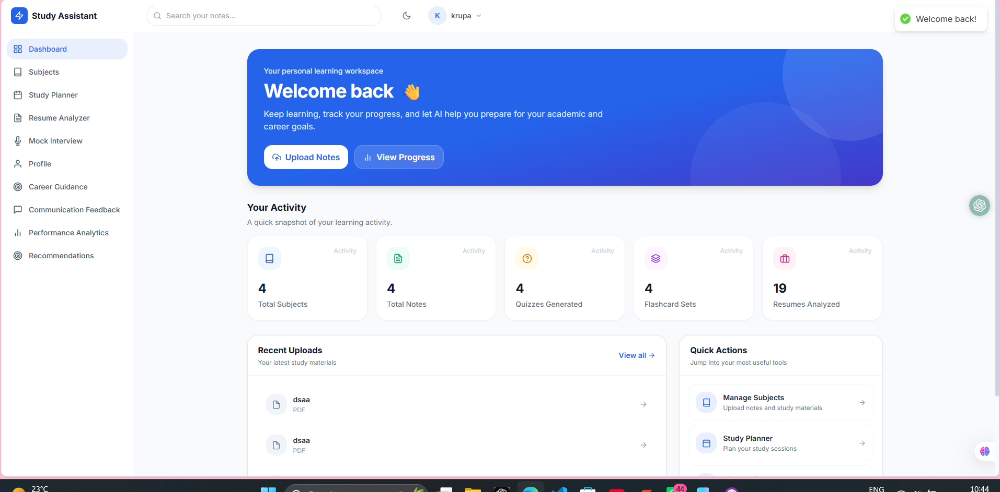
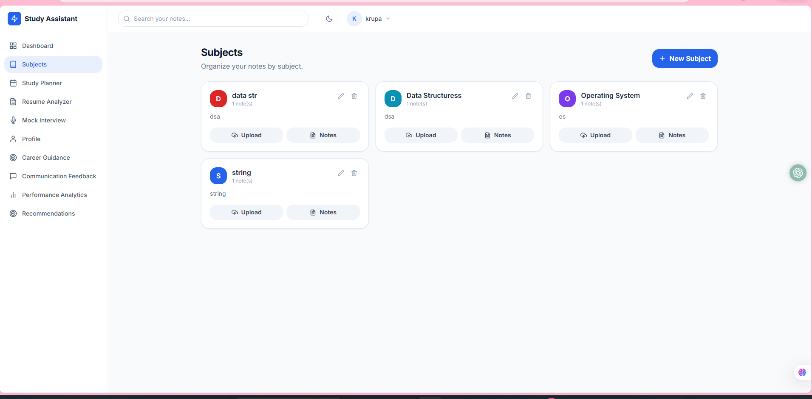
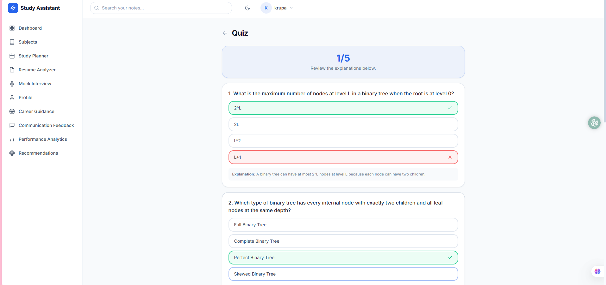
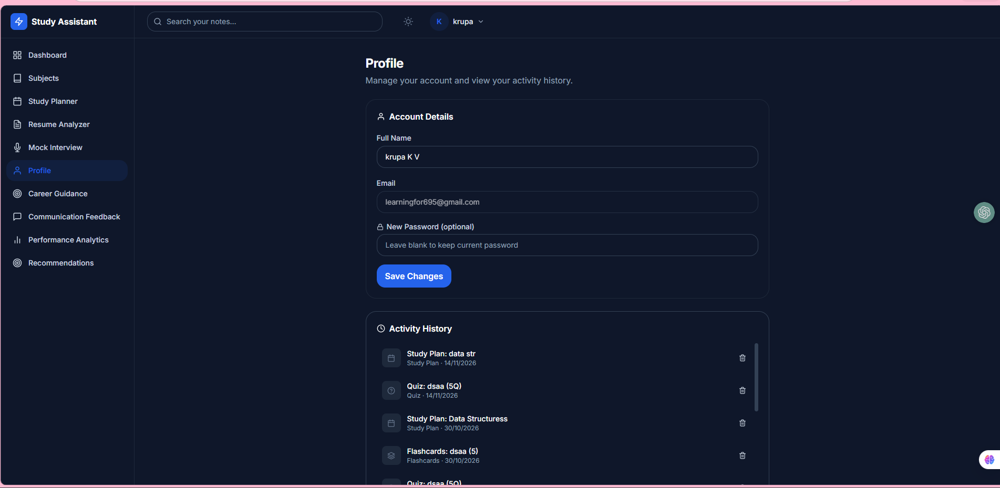

# 🎓 AI-Powered Student Academic & Career Assistant

An intelligent, AI-powered platform designed to simplify student life by bringing academic productivity, personalized learning, and career development tools into one unified application.

<p align="center">
  <strong>Learn Smarter • Study Better • Build Your Career</strong>
</p>

---

## 🚀 Project Overview

The **AI-Powered Student Academic & Career Assistant** is a web-based application that leverages Artificial Intelligence to support students throughout their academic and career journey.

The platform provides intelligent study assistance, personalized academic planning, AI-powered assessments, resume analysis, career guidance, and interview preparation tools.

It aims to create a centralized student companion that helps learners improve productivity, track academic performance, and prepare for future career opportunities.

## ✨ Key Features

### 📚 Academic Assistance
- **AI Notes Summarization:** Convert study materials into concise and understandable summaries.
- **AI Question Answering:** Ask academic questions and receive AI-generated explanations.
- **Quiz Generation:** Generate quizzes to evaluate subject knowledge.
- **Subject Management:** Organize and manage academic subjects.
- **Smart Study Plan:** Create and manage personalized study schedules.
- **Performance Tracking:** Monitor academic progress and performance.

### 💼 Career Development
- **Career Guidance:** Explore career opportunities based on interests and goals.
- **Career Goal Planning:** Set and manage professional career objectives.
- **Resume Analysis:** Analyze resumes and identify areas for improvement.
- **Mock Interview:** Practice interview questions and improve interview preparation.
- **Performance Board:** Track learning and career development progress.

### 👤 Student Management
- User Registration and Login
- Personalized Student Profile
- Communication and Feedback
- Centralized Academic Dashboard

## 📸 Application Screenshots

Explore the different modules of the AI Study Assistant.

### 1. Welcome Page


### 2. User Authentication

**Login Page**


**Sign Up Page**


### 3. Student Dashboard



### 4. Academic Management

**Subjects**



**Study Plan**


**Quiz Generation**



### 5. Career Development

**Career Guidance**


**Career Goal Planning**


**Resume Analysis**


**Mock Interview**


### 6. Student Performance and Profile

**Performance Board**


**Student Profile**



**Communication and Feedback**


## 🛠️ Technologies Used

| Component | Technology |
|---|---|
| Frontend | React.js |
| Styling | Tailwind CSS |
| Backend | Python, FastAPI |
| Database | SQLite |
| AI Integration | Groq API |
| Authentication | JWT |
| PDF Processing | PyMuPDF |
| API Testing | FastAPI Swagger UI |

## 🏗️ Project Architecture

The application follows a frontend-backend architecture.

- **Frontend:** Provides the interactive user interface using React and Tailwind CSS.
- **Backend:** Handles application logic and API requests using FastAPI.
- **Database:** Stores application data using SQLite.
- **AI Integration:** Uses Groq API for AI-powered functionality.
- **PDF Processing:** Uses PyMuPDF for extracting content from PDF documents.

## 📁 Project Structure

```text
AI-Study-Assistant/
│
├── backend/
│   ├── app/
│   │   ├── core/
│   │   ├── models/
│   │   ├── routers/
│   │   ├── services/
│   │   └── main.py
│   ├── requirements.txt
│   ├── Dockerfile
│   └── README.md
│
├── frontend/
│   ├── public/
│   ├── src/
│   ├── package.json
│   ├── vite.config.js
│   └── index.html
│
├── docs/
│
├── screenshots/
│
├── .gitignore
└── README.md
```

## ⚙️ Installation and Setup

Follow these steps to run the project locally.

### Prerequisites

Make sure you have installed:

- Python 3.12
- Node.js and npm
- Git
- A Groq API key

### 1. Clone the Repository

```bash
git clone https://github.com/krupaelon/AI-Study-Assistant.git

cd AI-Study-Assistant
```

### 2. Backend Setup

Navigate to the backend directory:

```bash
cd backend
```

Create a Python virtual environment:

```bash
python -m venv venv
```

Activate the virtual environment on Windows:

```bash
venv\Scripts\activate
```

Install the required dependencies:

```bash
pip install -r requirements.txt
```

Configure your environment variables in a local `.env` file using the configuration required by the application.

Add your Groq API key and other required settings. Never commit real API keys or passwords.

Start the FastAPI server:

```bash
uvicorn app.main:app --reload
```

Backend API documentation:

```text
http://127.0.0.1:8000/docs
```

### 3. Frontend Setup

Open a new terminal and navigate to the frontend directory:

```bash
cd frontend
```

Install dependencies:

```bash
npm install
```

Start the development server:

```bash
npm run dev
```

### 4. Access the Application

Open your browser and visit:

```text
http://localhost:5173/
```

The application should now be accessible locally.

## 🔐 Security

- API keys and sensitive credentials must be stored in environment variables.
- Never upload `.env` files containing real secrets.
- Keep private student documents and personal information secure.
- Do not commit database files containing private user data.

## 🎯 Project Objectives

- Make academic learning more interactive and efficient.
- Provide AI-powered academic assistance.
- Help students organize their study schedules.
- Support career exploration and professional development.
- Improve resume preparation and interview readiness.
- Bring academic and career tools into one platform.

## 🔮 Future Enhancements

- AI-powered personalized learning recommendations.
- Advanced academic analytics and progress reports.
- Integration with additional learning resources.
- Enhanced career recommendation system.
- Cloud deployment and improved scalability.
- More advanced mock interview evaluation.

## 👩‍💻 Developer

**Krupa K V**

Computer Science and Engineering Student

GitHub: [@krupaelon](https://github.com/krupaelon)

Project Repository: [AI-Powered Student Academic & Career Assistant](https://github.com/krupaelon/AI-Study-Assistant)

## 📌 Project Status

**Final-Year Academic Project — Under Development**

---

<p align="center">
  <strong>Empowering Students Through Artificial Intelligence 🚀</strong>
</p>